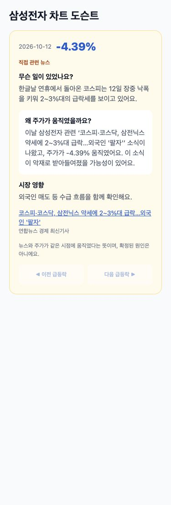
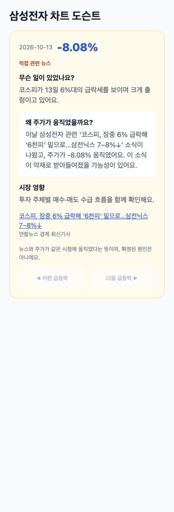
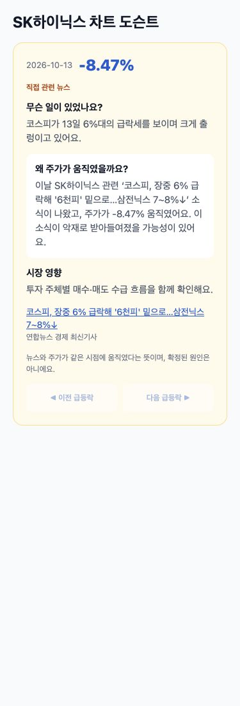
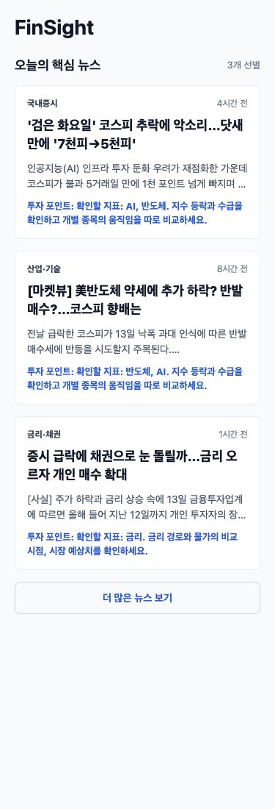

# 차트 대표 뉴스·사진 안내 정리 확인 (2026-10-13)

## 결과

| 종목·지점 | 대표 뉴스 | 결과 |
|---|---|---|
| 005930 2026-10-12 -4.39% | 232 코스피·코스닥, 삼전닉스 약세에 2~3%대 급락…외국인 '팔자' | 사진 캡션·행사 기사 없음 |
| 005930 2026-10-13 -8.08% | 324 코스피, 장중 6% 급락해 '6천피' 밑으로…삼전닉스 7∼8%↓ | 사진 캡션·행사 기사 없음 |
| 000660 2026-10-13 -8.47% | 324 코스피, 장중 6% 급락해 '6천피' 밑으로…삼전닉스 7∼8%↓ | 사진 캡션·행사 기사 없음 |

하락/상승 방향 +3, 종목명/StockCatalog 별칭 +2, 제목·리드 지수 등락 +1, 행사 -3, 기관·지자체 주어 -2, 반대 방향만 있으면 -2로 정렬합니다. 동일 점수는 관련성과 안정적인 기사 ID 순으로 비교하며 발행 시각으로 역전하지 않습니다. 1점 미만 기사는 고르지 않고 NONE 설명을 제공합니다.

일봉 후보 범위는 해당일 00:00부터 다음날 09:00 직전(KST)입니다. 232번의 삼전/닉스 약칭을 인식합니다. 도슨트 3칸은 선택된 첫 기사에 맞춰 생성합니다. 시장 수치는 기존 지수 캔들 캐시에 있을 때만 사용합니다.

기존 chartResponses/시세 캐시를 지우지 않고 저장된 캔들에 DB 뉴스를 다시 점수 매깁니다. 도슨트 캐시만 news-direction-v2 버전으로 분리합니다. 캐시 갱신에서 일봉/분봉 시세 클라이언트를 호출하지 않는 JUnit을 포함합니다.

사진 안내/크레딧은 backend ArticleContentExtractor.stripPhotoNoise 및 AI의 동일 규칙으로 표시·생성 때 정리합니다. 홈 요약·기사/판단 화면 요약·학습 저장 요약·도슨트에 적용했고 raw_content는 수정하지 않았습니다.

읽기 전용 SQL 집계: 사진 안내/크레딧 패턴 46건, 단순 ‘사진은 기사와 관련 없음’ 유형 1건.

```sql
SELECT count(*) FROM news
WHERE raw_content ~ '(사진은 기사와 관련 없음|사진은 기사 내용과 무관|이미지는 기사와 관련 없|자료사진|일러스트=|그래픽=|사진=)';
```

## 검증

AI pytest 130개, frontend typecheck/test 78개 통과. 백엔드 ./gradlew test 통과, JUnit {'tests': 174, 'failures': 0, 'errors': 0, 'skipped': 4} 및 Python 12개(기존 7 + 백필 5). 로컬 build/classes에 생긴 ‘클래스명 2.class’ 중복 산출물 18개만 제거한 뒤 정상 재실행했습니다. 소스/DB 삭제 없음.

## 375px 화면

아래는 실제 앱의 ChartDocentPanel/NewsSection 컴포넌트 캡처입니다. DB 기사와 사용자가 제시한 재현 등락률을 사용했고 가격 차트나 종가를 합성하지 않았습니다. 시세 재호출을 피하기 위해 도슨트 카드/홈 뉴스 영역을 별도 렌더링했습니다. 전체 ChartScreen의 라이브 시세까지 재검증한 캡처로 해석하면 안 됩니다.






홈 반복 안내는 이전에 병합된 NewsSection에서 이미 제거됐습니다. 현재 코드에는 ‘핵심 내용을 하나씩’ 또는 focusHint 렌더링이 없고 테스트 및 현재 데이터로 재확인했습니다. RSS 수집처는 연합뉴스/한국경제/매일경제이며 수집 결과 중 핵심 3개를 홈에 선별합니다.
